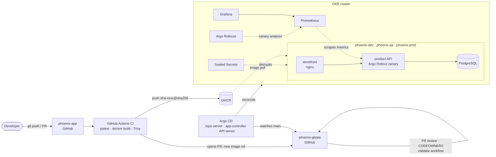

# Architecture

**Key principle:** CI builds and validates artifacts. GitOps CD deploys the desired state recorded in Git.

## Components

| Layer | Component | Notes |
|---|---|---|
| Frontend | nginx + static storefront | Proxies `/api/*` to the product API. LoadBalancer Service per env |
| Product API | Flask + gunicorn | `/api/products`, `/api/cart/<session>`, `/healthz`, `/readyz`, `/metrics`. `ERROR_RATE` simulates bad releases |
| Database | PostgreSQL 16 StatefulSet | Password from a **SealedSecret** |
| CD | Argo CD | AppProject `phoenix` (least privilege), RBAC roles `student` and `release-manager` |
| Config | Kustomize (Days 3–5), Helm (Day 6+) | ApplicationSet generates `phoenix-dev/qa/prod` |
| CI | GitHub Actions | Test → build → Trivy → GHCR → PR to phoenix-gitops |
| Progressive delivery | Argo Rollouts | Canary 25% → 50% → 100% with Prometheus analysis on the canary's own pods |
| Observability | kube-prometheus-stack | ServiceMonitor + "Phoenix — Application & Deployment Health" dashboard |

## End-to-end delivery workflow

1. **Developer commits code.** Feature branch → PR → merge to `main` on `phoenix-app`.
2. **CI runs.** Unit tests, image build, Trivy scan (fails on fixable CRITICAL issues).
3. **Image is published.** `ghcr.io/phoenixgcp/phoenix-backend:sha-abc1234`, and CI records the digest.
4. **GitOps config is updated.** CI opens a PR on `phoenix-gitops` that sets `values-dev.yaml` to `sha-abc1234@sha256:…`.
5. **Change is reviewed.** The `validate` workflow renders and schema-checks everything. Prod changes need CODEOWNERS approval.
6. **Argo CD reconciles.** dev and qa auto-sync. Prod is synced manually by a release manager.
7. **Health is verified.** Readiness probes, Argo CD health, the Grafana dashboard, and the Rollouts analysis.
8. **Drift and failures are handled.** Self-heal reverts manual changes, and a failing canary aborts automatically.

## Environments

| | dev | qa | prod |
|---|---|---|---|
| Namespace | `phoenix-dev` | `phoenix-qa` | `phoenix-prod` |
| API replicas | 1 | 2 | 4 |
| Sync | auto | auto | manual |
| Who can sync (RBAC) | student, release-manager | release-manager | release-manager |
| Load generator | on | on | off |
